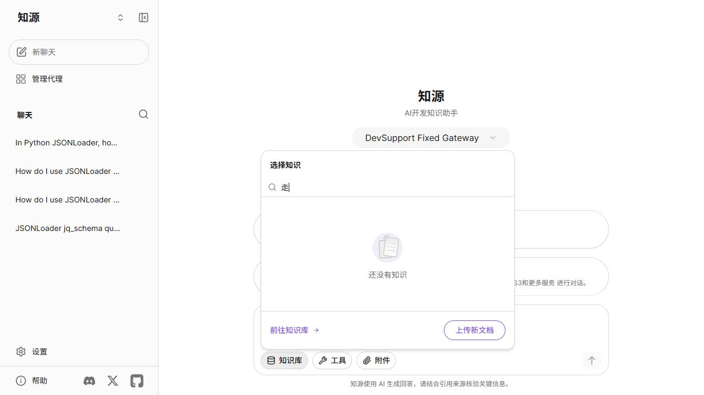
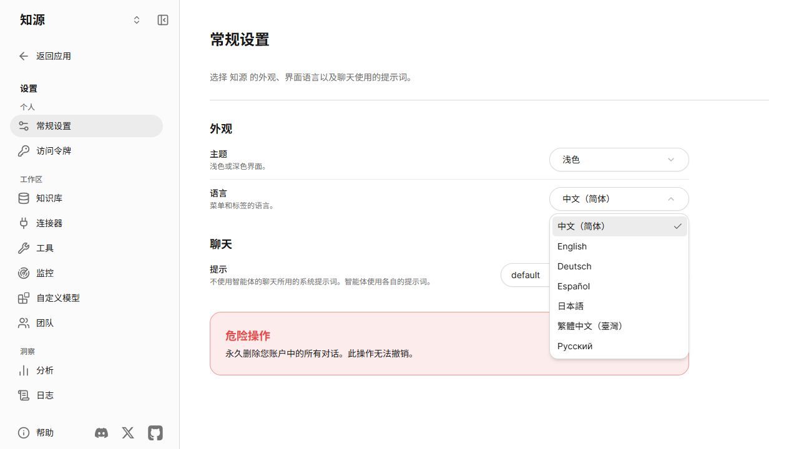
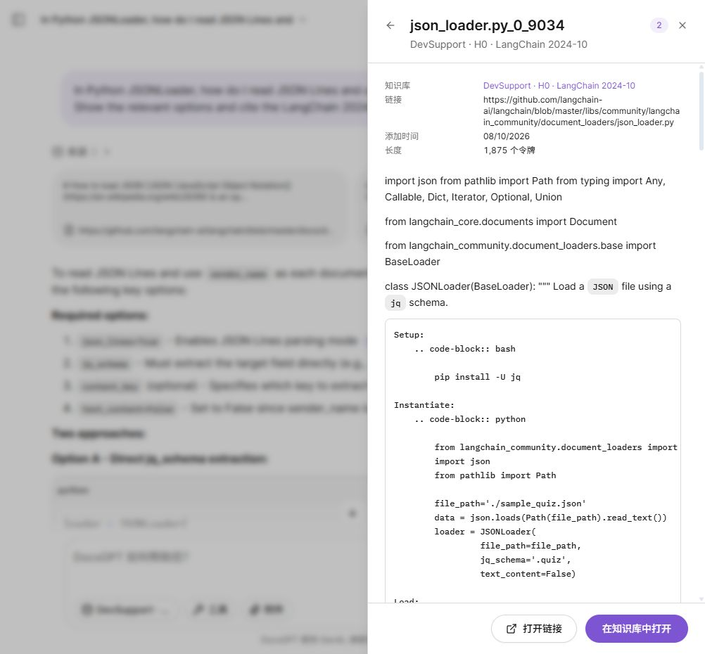

# 知源 · 个人 RAG 知识助手

**把自己的文档变成可检索、带引用、能核验的知识库。**

知源是一款支持自定义文档的个人 RAG 知识助手。上传笔记、产品手册或项目资料，等待系统解析和建立索引，再选择知识库提问；回答提供来源，方便回到原文核对。添加文档不需要重新训练大模型。

项目基于 **DocsGPT 二次开发**，复用成熟的聊天、上传、会话和引用能力，重点改进首次使用体验、技术文档检索、证据追溯和评测闭环。**AI 开发文档与源码是一个演示知识库，产品本身不限定知识主题。**原实验代号 DevSupport Copilot 保留在代码及实验记录中。

在固定 AI 开发演示中，系统使用 Dense + BM25 + RRF 混合检索，同时保留标识符检索、现代重排、按需查询分解和证据门控等可选实验。通过逐题对照和消融决定保留什么，而不是把所有组件默认开启。

> 首版状态：工程预览。已完成八种检索条件的 150 题本地留出评测、开发集回答与决策实验、原生界面与引用集成；完整留出回答、复检与门控评测仍在进行。人工审核暂缓，实际数量为 0。

## 系统已实现什么

| 功能 | 用户可以做什么 / 系统如何处理 | 当前范围 |
|---|---|---|
| 自定义知识库 | 上传 TXT、Markdown、PDF、DOCX 等原始文件，选择不同来源进行问答 | 复用并验证 DocsGPT 原生上传、入库与检索 |
| 自动入库与分块配置 | 系统解析、切分、生成 embedding 并建立索引；来源设置可配置分块策略，修改后重新索引 | 普通知识库；FreshStack 实验保留官方语料块 |
| 带引用的知识问答 | 对文档内容提问，打开来源核对证据 | 原生问答与引用已集成；引用存在不保证语义正确 |
| 技术文档混合检索 | 同时利用自然语言语义与 API、参数、报错中的关键词，通过 RRF 融合 | 固定 AI 开发演示默认 H0；不自动套用到任意新文件 |
| 现代重排与有限复检 | 比较 Qwen3/Jina 重排；必要时保留原查询，最多增加两条子查询、复检一轮，失败回退首轮证据 | 已实现、可选实验；默认关闭 |
| 证据门控与引用校验 | 实验性判断回答、追问或证据不足；校验输出引用是否指向本次提供的证据，记录失败和修复 | 引用校验属于演示回答流程；gate 默认关闭 |
| 固定中英文使用说明 | 首页给出入门步骤、示例 TXT 和帮助入口；独立产品介绍问题直接返回固定说明 | 默认中文，可切换 English；帮助不调用 AI |
| 可复现评测 | 固定数据、模型与配置，记录逐题结果、失败分母、组件消融、配对区间和已知调用用量 | 八种检索条件 × 150 题已完成，后续回答评测进行中 |

**两条数据路径：**自己的文件走原生知识库入库与问答；固定 FreshStack 快照走本项目共享检索/回答与实验流程。下方量化提升来自第二条路径，不代表新上传文件已经获得相同增益。

## 相对 DocsGPT 原版，改进在哪里？

DocsGPT 本身已经提供文档上传、聊天、来源引用、多语言和丰富的 Agent/工具能力；部分向量后端也支持 Hybrid/RRF。本项目保留这些能力，不把上游已有功能写成原创。新增价值集中在以下方面：

| 方面 | 上游基础 / 本项目改动前 | 本项目的具体改进 | 验证依据 |
|---|---|---|---|
| 技术文档检索 | 检索效果随 embedding、向量后端及配置变化，不能笼统视为只做 Dense | 为固定演示建设 Dense、普通 BM25、标识符 BM25、RRF 与现代重排的独立对照 | 同一 150 题留出集；H0 相对受控 Dense 的 Coverage@10 **+8.59pp** |
| 来源可追溯 | 上游已有引用能力 | 实验引用绑定官方证据 ID、索引快照原文与文本校验值，避免外链最新内容替代历史证据 | [架构与快照说明](devsupport/docs/ARCHITECTURE.md)、实际引用截图 |
| 评测与产品取舍 | 原版是通用产品，不能假设其没有测试或评测 | 新增 FreshStack DEV53 / TEST150、本地冻结配置、逐题记录、失败分析与消融；演示和评测共用实现 | [公开检索结果](devsupport/reports/public-complete-local-test-v2/summary.json)、[实验记录](devsupport/docs/EXPERIMENTS.md) |
| 首次使用 | 本地改版前的产品介绍可能落入通用模型回答，缺少本项目固定说明 | 增加四步引导、独立中英文指南、示例文档及固定介绍；帮助无需模型猜测 | [首次使用指南](GETTING_STARTED.md)、前端回归与实际页面验证 |
| 故障与复杂流程 | 通用 Agent/工具能力不等于本实验的有界复检协议 | 对查询分解设置次数和标识符约束，区分接口失败、输出校验失败与有效拒答，保留全部尝试 | [失败分析](devsupport/docs/FAILURES.md)、可选复检与 gate 实验 |

这里的 **+8.59pp 是相对受控 Dense 基线的检索提升，不能写成“全面超越原版 DocsGPT”**。本项目还测了原生 ClassicRAG 的 U 条件：共用 Qwen embedding，其 top-10 指标与 B0 一致；它不是原版默认 Granite 模型配置，因此仍不能作为原版所有默认能力的成绩。也尚未证明回答准确率、端到端速度或成本同步改善。

## 第一次下载 / 使用？

先看 **[首次使用指南](GETTING_STARTED.md)**：它给出依赖、自己的 API 配置、源码启动、上传示例文档、选择知识库和核验引用的完整步骤。普通文档问答无需先下载整个 FreshStack 评测集。 源码启动前需要把 `frontend/.env.example` 复制为自己的 `frontend/.env.local`，使页面请求本地 API；模板不含模型密钥。

网页首页直接显示 **上传文档 → 等待入库 → 选择知识库 → 提问并查看引用**，并提供知识库和固定使用指南入口；帮助菜单也能打开说明。使用指南含可下载的示例 TXT。产品介绍、功能限制和使用方法均为固定的中英文文本；“知源是什么”之类的独立产品问题在前端直接返回固定说明，不调用模型或联网搜索。带附件和正常文档问题保留原检索路径。

下载的是源码，不是带数据库、模型和密钥的桌面安装包。本次已验证现有环境的前端构建和实际界面；未宣称全新机器一键安装已通过。

## 解决什么问题

用户可以上传自己的文档，建立并选择独立知识库，再围绕其中的内容提问、查看回答引用。AI 开发知识只是本项目的演示场景，不限制知识库的主题。

演示中，开发者排查 JSONLoader、参数配置或 Agent 集成问题时，常遇到 API 名称相近、文档和代码分散、搜索遗漏关键步骤、回答缺乏适用证据等问题。本项目支持输入自然语言、代码标识符和报错，返回解释与下一步建议，并提供保存的文档或代码快照引用。

用于优化实验和量化评测的知识库固定为 FreshStack 的 LangChain 2024-10 快照，不能作为当前版本完整支持。界面复用 DocsGPT 的聊天、上传、会话和引用展示能力；项目重点是检索、证据组织、有限复检、回答决策及评测。

## 知识库可以自定义吗？

可以。DocsGPT 原生上传流程支持把自己的文档建立为独立知识库，并在提问前选择相应来源；已有上传、入库与检索验证。产品名称为“知源 · 个人 RAG 知识助手”，AI 开发文档是示例知识库。

新建或更换知识库通常不需要重新训练大模型。入库过程是解析文档、切分文本、生成 embedding 并建立检索索引；提问时从所选知识库检索证据，再交给已有模型生成回答。不同文件格式可能需要不同解析方式，但基本流程一致。

界面默认简体中文，可在“设置 → 常规设置 → 语言”切换 English，并保存选择。知识库管理的“来源设置”提供经典、递归、Markdown、父子和语义分块选项；修改分块参数需要重新索引。当前原生上传测试知识库使用经典分块（最大 1,250 tokens、最小参数 150 tokens），Qwen3-Embedding-0.6B 与 FAISS 建立向量索引。小于最小参数的片段仍可保留，它不是强制下限。

固定 FreshStack 快照走本项目优化与评测流程，新上传文件走原生知识库流程；新文件不会自动混入实验索引。现有指标只适用于固定评测材料，不能直接推广为其他知识库的质量提升。

## 已验证的结果

语料审计得到 **49,505 个唯一证据 ID**；203 个问题分为 53 问 DEV 和 150 问本地留出集。下表为完整 150 问的排名指标。

| 条件 | Coverage@10 | α-nDCG@10 |
|---|---:|---:|
| Dense / B0 | 49.06% | 0.2671 |
| 原生 ClassicRAG / U（共享 Qwen） | 49.06% | 0.2671 |
| 普通 Hybrid + RRF / H0 | 57.64% | 0.3254 |
| 标识符 Hybrid / H1 | 57.84% | 0.3274 |
| 逐对重排 / R1 | 54.23% | 0.3251 |
| Listwise 重排 / R2 | 55.71% | 0.3376 |

H0 相比 Dense 的 Coverage@10 提升 **8.59 个百分点**，95% 配对 bootstrap 区间为 **[+3.16, +13.53] 个百分点**。BM25-only、原生 U 和语境前缀 C 也已完成同一 150 问对照，完整数字见[公开汇总](devsupport/reports/public-complete-local-test-v2/summary.json)。这是自行建立的本地划分，不是官方 benchmark split。

α-nDCG@10 从 **0.2671 提高到 0.3254（+0.0583）**，反映前部结果对所需信息的排序与覆盖改善。8 种方法共 **1,200 条检索记录**，该批检索阶段的运行错误为 **0**；此结论不包含仍在进行的付费回答生成。

**该收益不能写成回答准确率提升。** 在固定 4,000 代理-token 预算下，H0 相比 Dense 的装箱后证据覆盖仅提升 0.78 个百分点，区间跨零。标识符处理、现代重排、复检和门控均已实现并开展实验，但现有 DEV 证据不足以支持全部默认开启，因此最终默认方案在 TEST 前选择为 H0。

## 架构与实验范围

```text
DocsGPT UI → 共享检索与回答 Pipeline → 快照引用
                       │
             Qwen3 Embedding + FAISS
             BM25S + RRF
             可切换重排 / 有限复检 / Evidence Gate
                       │
             固定预算装箱 → 引用校验 → 回答
```

- 标识符检索：完整符号和拆词并存，单独与普通 Hybrid 对照。
- 现代重排：Qwen3-Reranker-0.6B 与 Jina Reranker v3.5 使用相同 50 项候选池；保留输入顺序诊断及负结果。
- 有限复检：比较不分解、全部分解、按需分解；保留原问题，最多两条子查询、一轮复检。
- Evidence Gate：回答、追问或证据不足的实验决策；与复检独立评估，失败不能算有效拒答。
- 评测：保存逐题结果、配置与数据身份、失败分母、配对区间、阶段耗时及已知 provider usage。

默认 H0 关闭复检和 gate；上述实验功能的实现完成不等于已经证明质量收益。正式 Full 为 H0 的评测别名，旧 UI 的实验性 Full 来源与其不同。

## Demo 与阅读入口

现有[5 分 18 秒工程 MVP 视频](devsupport/reports/demo/native-live-20261009-v1/devsupport-mvp-captioned.mp4)展示保存的真实回答、文档/代码快照及知识库页面。视频采用实际网页操作截图采样，采样空隙公开；不是系统连续录屏，也不是最终留出验收视频。单例回答存在已记录的语义错误。







| 想了解的内容 | 文档 |
|---|---|
| 用户、任务与范围 | [PRD](devsupport/docs/PRD.md) |
| 架构与实现 | [架构说明](devsupport/docs/ARCHITECTURE.md) |
| 组件贡献与消融 | [实验记录](devsupport/docs/EXPERIMENTS.md) |
| 无收益组件与失败原因 | [失败分析](devsupport/docs/FAILURES.md) |
| 环境、数据获取、索引与启动 | [运行手册](devsupport/docs/RUNBOOK.md) |
| 已完成和待完成的范围 | [验收清单](devsupport/docs/ACCEPTANCE.md) |
| 面试讲述与简历模板 | [面试材料](devsupport/docs/INTERVIEW.md) |
| 首版范围和后续主分支规则 | [发布方案](PUBLISH_PLAN.md) |

复现需要下载固定版本的数据和模型、配置自己的模型 API、启动 DocsGPT 与独立模型/检索服务。本仓库不分发凭证、账户记录、数据库、索引和模型权重。当前运行手册记录 Windows + WSL 实际环境，尚未声明任意平台一键安装。

## 来源与限制

基于 [DocsGPT](https://github.com/arc53/DocsGPT) 的固定版本进行二次开发，保留上游 MIT 许可证与来源说明。界面、上传和基础会话并非项目原创；独立实现及实验主要位于 `devsupport/` 与 DocsGPT 的检索/回答适配器。

FreshStack 数据声明 CC-BY-SA-4.0；Qwen 模型声明 Apache-2.0；Jina 模型声明 CC-BY-NC-4.0，作为独立非商业实验组件。具体版本及归属见[来源记录](devsupport/docs/PROVENANCE.md)。

生成与 AI 评审使用授权第三方网关的固定路由，底层模型身份未独立验证；不能将返回模型名当已验证的原厂模型成绩。AI 评价不等于人工验证，未知费用保持未知。JSONL 解析故障后的修正重跑保留原结果、方法与参数，不能当独立重复实验。
