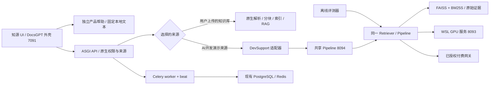

# 架构与工程决策

更新：2026-10-10。产品名称为“知源 · 个人 RAG 知识助手”，DevSupport 保留为专业演示和实验模块名称。

普通上传资料走 DocsGPT 的原生入库和检索路径；FreshStack 演示来源走独立共享 pipeline。两者都能用于知识问答，但专用 Hybrid 实验并未自动迁移到任意上传知识库，不能把专业演示成绩归给普通上传功能。

产品帮助是第三条路径：`productHelp.ts` 使用已初始化的 i18next 实例读取固定中英文文本，Redux 不触发 React 翻译初始化。独立帮助请求在 `fetchAnswer` 中直接返回，不发出回答请求；历史产品问答在显示层替换为同一说明，服务器原记录仍保留。正常内容问题或带附件请求不走帮助快捷分支。首页与 `/help` 页面提供上传、等待入库、选来源、查引用的步骤，说明见根目录 `GETTING_STARTED.md`。

## 数据与接口边界

`src/devsupport/types.py` 定义 Evidence、Hit、Question。Question 及其答案/nuggets 只用于离线评测；在线 pipeline 接受字符串问题和运行配置。数据 manifest、索引 manifest 与每次实验 manifest 记录原始文件、模型、代码、配置与 split 身份，避免更换配置后复用旧结果。

49,514 行原始档案不改写；`official_last` 审计后索引包含 49,505 个唯一 ID。可选 contextual 索引只改变索引表示，不替换证据正文。原生引用使用保存的快照，原始 URL 是外部参考链接。

C 全量 contextual 索引现已 complete_verified：49,505 ID，embedding 约 1,850.854 秒，输入截断 7,327 项。仅使用已有 URL/path/heading metadata；原始证据不变，截断统计保留。其 DEV 收益不能替代 TEST 或生成比较。

## 检索、扩展与生成

Qwen3-Embedding-0.6B 在独立 WSL GPU 环境推理；归一化 1,024 维向量用于 CPU FAISS。普通 BM25 与标识符 BM25 保留不同的词法实验语义；标识符分词保留完整 API/snake_case/camelCase/错误码并提供受控子词。融合去重使用官方 ID、RRF 60 和 50 项候选上限。

R1 为真实 Qwen3 pairwise，R2 为真实 Jina v3.5 listwise，两者不能串联；公平比较复用同一 H1 候选池。DEV 暂不支持引入重排作为默认收益组件。

Q 的扩展策略 never / always / selective 与 G 的最终证据门控独立。原问题始终保留，最多两条子查询和一轮追加检索。门控输出 answer / clarify / insufficient，重排分数不是置信概率。最终回答的行内编号与 citation_ids 必须对应实际来源。

扩展校验只从原问题识别显式标识符：ASCII `[A-Za-z_][A-Za-z0-9_]*` 及其 `.` / `::` 限定名、去掉首尾下划线后仍含下划线的名称、含“小写字母或数字紧接大写”或“两个大写紧接小写”的混合大小写名称，以及单反引号内完整的一个上述 ASCII 标识符/限定名。普通首字母大写词和未标记的小写词不锁定；不声称识别所有 API 或实体，也不从证据、答案或 gold 推断名称。去重并移除与原问题相同的子查询后，剩余子查询的并集必须以完整词法 token 保留所有识别名称的精确大小写；更长名称或限定名前后缀不算保留，句末句点可接受。没有剩余子查询则不追加检索。该语法规则也可能锁定看似代码的域名，且不覆盖任意代码表达式或非 ASCII 标识符。

当前实现先检查模型输出结构合法，再使用 `devsupport-identifier-anchoring-v1` 策略补齐缺失标识符：按排序后的精确名称依次追加到当前最短子查询，长度相同按原顺序选择，每条仍不得超过 512 字符。程序不猜测别名、不截断文本、不增加第三条查询；不能容纳全部名称时整次回退，不检索部分补齐结果。随后仍执行原有严格校验，失败则保留首轮证据。trace 分别记录模型子查询、实际子查询、补齐名称与策略版本，runtime hash 包含策略版本。这是新协议，旧失败日志不重写。真实 DEV53 对照已完成，按需分解装箱覆盖增量的区间跨零，未建立质量收益；当前常驻服务已更新至包含该策略的源码，但 UI 默认 H0 未启用扩展，不能据此称 UI Full 已验收。

`answer.py` 当前默认使用 `ProxyTokenCounter`：4,000 `cl100k_base_proxy_v1` 代理 tokens，计入来源表和 metadata，超长块整体跳过。tokenizer 读取上游打包的 `docsgpt/core/encodings/cl100k_base.tiktoken`，SHA256 为 `223921b76ee99bde995b7ff738513eef100fb51d18c93597a113bcffe865b2a7`，不经网络下载。网关底层生成 tokenizer 未验证，故仍标记 `exact_generation_tokens=false`。

旧 `Utf8BudgetCounter` 的 4,000 UTF-8 字节策略造成严重证据不足，已不作为默认协议，历史装箱报告保留为已取代诊断。统一新预算下 H0 装箱覆盖高于 H1，说明候选排名优势不能替代最终上下文和付费回答验证；所有方法必须使用相同计数器及预算。

提交 `d48a126` 避免对已经计入预算的来源表再次 JSON 转义，当前 answer prompt 为 `devsupport-answer-v2`。2026-10-09 已完成当前 v2 的原生 H0 回答与快照引用复验，证据见 `reports/ui/native-v2-answer-success-20261009.json`。这只证明工程通路，回答仍有 text_content 理由错误；不是基准准确率或人工验证。诊断脚本 `scripts/audit_context_budget.py` 复用完整有序 DEV 缓存排名，无模型推理或付费请求，保存协议/输入哈希与装箱结果。

`Pipeline.retrieve` 将准备好的证据保存在服务端；`answer` 消费服务端 search_id，校验查询一致性，不信任客户端回传证据。错误、截断和模型身份不匹配应保留诊断，不作为有效质量样本。

## 运行隔离与可观测性

原生应用使用 Python 3.12；轻量 pipeline 使用 Windows core venv；模型服务使用 WSL CUDA venv。各服务绑定 loopback。原生 API、worker、beat 分别启动，worker 负责原生上传/后台处理，beat 负责调度。现有数据库和 Redis 保留，不以清空容器排障。

Provider trace 包含 requested_model、actual_model、identity_status、usage、成本状态、重试、截断、stage 与等待时间。当前网关路由映射并不能证明底层 DeepSeek 或 Opus 身份。65 秒共享 pacing 用于减少并发冲击；调用失败或封禁时停止付费任务，禁止自动充值。

## 决策记录

| 决策 | 理由与代价 |
|---|---|
| 复用 DocsGPT 与共享 pipeline | 避免演示 UI 与评测走不同检索实现；增加适配和多进程运行成本 |
| 完整语料、官方 ID 和审计去重 | 保留可比性及困难干扰项；索引和实验更耗时 |
| 正式默认 H0，不加 R/Q/G | 完整 DEV 评价及控制完成后在 TEST 前选定；TEST150八种本地条件已完成，其余生成/控制/复检仍在验证，不能依 TEST 改选 |
| Q/G 分开消融 | 避免把多检索与多拒答混成单一收益 |
| 统一代理 token 装箱 | 替代造成证据不足的旧字节协议；可复现但不等同未知生成 tokenizer |
| 配置后 U 单列 | U 共用 Qwen，且原生 45,000 token 候选预算会裁剪；不可冒充原厂默认基线 |
